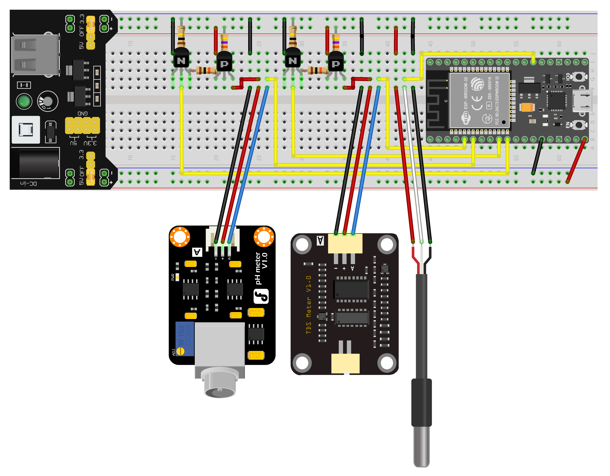
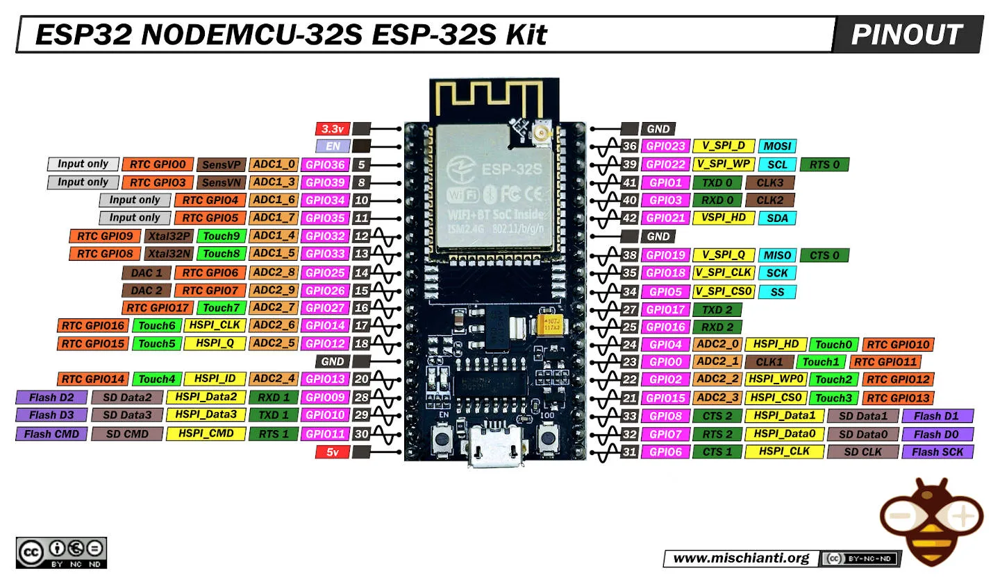

# Fish tank water quality monitoring

## Sensors
### Temperature

- DS18B220
- GPIO4 on ESP32s

### pH

- DF Robot Gravity: Analog pH Sensor V2(PRO)
  - Needs 4.0 and 7.0 pH calibration fluid
- GPIO35 on ESP32S

### TDS
- DF Robot SEN0244-TDS sensor and breakout
  - Needs 1413 µS/cm calibration fluid
- GPIO34 on ESP32S

## Wiring
- 
- To prevent cross talk and excessive current loss, the TDS and pH sensors have high side switching to turn them on and off for readings
- I only had some random transistors available (2N7000 and S8550), so the power switching circuit is unusual

## Controller
- Nodemcu ESP32S v1.1
  - 
- Publishes data readings to MQTT
- Docker container running a rust script bridges MQTT to SQL
- Data stored in a Postgres database
